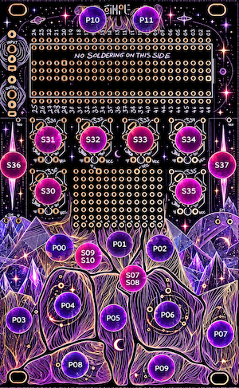

# NUUT - Celestial Harmonic Synthesizer

NUUT is an experimental polyphonic synthesizer inspired by celestial harmony and astrological relationships.
The instrument explores harmonic relationships, evolving polyphonic structures and crystal-inspired sound transformations.

NUUT is being developed as an instrument for the Synthux Academy Touch 2, built around the Electro-Smith Daisy Seed platform.

## Controls



<h3>Switches</h3>

- S07-S08 - **Crystal Effect Chain** (Obsidian - down | Amethyst - center | Aquamarine - top) | Selects the active Crystal processing chain
- S09-S10 - **Transit Mode** (Evolving | Off | Drifting) | Controls the Transit movement mode and automatic planetary movement

<h3>Knobs</h3>

- S30 - **Celestia** | Adds additional planetary voices beyond the 3 main voices
- S31 - **Origin** | Controls the harmonic root / pitch center and shifts the whole system around the central tuning. It moves in semitone steps: the centre is the original tuning, and the extremes are one octave down and one octave up
- S32 - **Kosmos** | Continuously reshapes the harmonic relationships between the 3 main planetary voices, moving between consonant and more complex intervals
- S33 - **Arc** | Controls the envelope of all active voices, shaping global attack and release time
- S34 - **Refraction** | Controls spatial dispersion, stereo behavior and distinctive sonic activity of the selected Crystal effect
- S35 - **Crystal Mix** | Controls the balance between the dry signal and the Crystal-processed signal

<h3>Faders</h3>

- S36 (left) - **Transit** | Controls planetary orbital movement through the 360° system, enabling astrological events that trigger additional harmonic modulations and sonic transformations
- S37 (right) - **Alchemy** | Shapes the tonal character and timbral response of the voices
  - **Hold P10 + move S37** - **Wave Morph** | Morphs the oscillator waveform of the 3 main voices: fader up = sine, middle = triangle, fader down = sawtooth. Alchemy stays where it was

<h3>Pads</h3>

- P01...P10 - **Planets** | Represent the 10 planetary bodies and determine the main planetary voices and their harmonic relationships
- P10 - **Shift** | Second-layer modifier. While held, the Alchemy fader controls Wave Morph instead of Alchemy
- P11 - **Hold** | Sustains the selected planetary voices after releasing the corresponding pads. In Hold, touching a held pad releases it. With 3 pads already held, touching a new pad replaces the oldest one

<h3>Second-layer functions</h3>

Some controls have a second function that is reached by holding the Shift pad (P10) while moving them.

| Hold | Control | Function |
|------|---------|----------|
| P10  | S37 Alchemy fader | Wave Morph (sine - triangle - sawtooth) |

Each control keeps its own value when you switch layer. After pressing or releasing P10, the fader picks the stored value up again only when it reaches it, so the sound never jumps.

<h3>LED Indicator</h3>
The onboard LED lights up when Hold is active.

## Build and upload

Requires the [Daisy Toolchain](https://docs.daisy.audio/tutorials/cpp-dev-env/) (ARM GCC + make). On Windows, use Git Bash.

```
git clone --recurse-submodules <repo-url>
make clean && make
make program-dfu   # with the Daisy Seed in DFU mode
```

The binary is `build/nuut.bin`.

## Known limits (test firmware)

- With 3 pads, high Alchemy and the Amethyst crystal, the CPU can reach about 99-100% and an occasional light crackle may be heard.

## License

NUUT is released under the MIT License. See the [LICENSE](LICENSE) file.

## Credits

- [libDaisy](https://github.com/electro-smith/libDaisy) - Electro-Smith, MIT License
- [DaisySP](https://github.com/electro-smith/DaisySP) - Electro-Smith, MIT License. The LGPL modules (enabled with `USE_DAISYSP_LGPL`, which include the ReverbSc reverb) are licensed under the LGPL
- Synthux Academy Touch 2