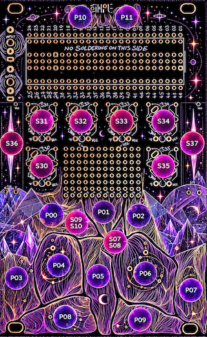

# NUUT - Celestial Harmonic Synthesizer

NUUT is an experimental polyphonic generative synthesizer for the Synthux Academy Touch 2, built on the Electro-Smith Daisy Seed.

Inspired by celestial harmony, planetary motion, astrological aspects and crystals.

- Web interface (follows your Touch live): <http://ametistawaves.com/nuut>
- Manual (PDF): <http://ametistawaves.com/nuut/manual.pdf>

## Controls



<h3>Switches</h3>

- S07-S08 - **Crystal Effect Chain** (Obsidian - down | Amethyst - center | Aquamarine - top) | Selects the active Crystal processing chain
- S09-S10 - **Transit Mode** (On - down | Off - center | Linger - top) | Selects how the sky moves. **On**: the Transit fader sets the speed of the sky. **Off**: the sky stands still and the Transit fader moves it. **Linger**: like On, but the sky slows down when two planets approach an aspect

<h3>Knobs</h3>

- S30 - **Celestia** | Adds additional planetary voices beyond the 3 main voices (up to 7)
- S31 - **Origin** | Controls the harmonic root / pitch center and shifts the whole system around the central tuning. It moves in semitone steps: the centre is the original tuning, and the extremes are one octave down and one octave up
- S32 - **Kosmos** | Builds a chord on the first planet you press and moves the other voices onto its notes. Zone 0 leaves the planets as they are; the other nine zones are Power, Sus4, Sus2, Minor, Min7, Major, Maj7, Add9 and Lydian
- S33 - **Arc** | Controls the envelope of all active voices, shaping global attack and release time
- S34 - **Refraction** | Controls the depth and the distinctive activity of the selected Crystal effect. Amethyst: longer climbing echoes and a louder octave halo. Aquamarine: faster ping-pong bounces. Obsidian: wider resonance and louder echoes
- S35 - **Crystal Mix** | Controls the balance between the dry signal and the Crystal-processed signal

<h3>Faders</h3>

- S36 (left) - **Transit** | Controls planetary orbital movement through the 360° system, enabling astrological events (aspects) that trigger instruments and chords. In Off mode it moves the sky; in On and Linger it sets the speed
- S37 (right) - **Alchemy** | Shapes the tonal character and timbral response of the voices: up, the comb, echo and resonance of the Alchemy stage; down, brightness (FM and air)

<h3>Pads</h3>

- P00...P09 - **Planets** | Represent the 10 planetary bodies and determine the main planetary voices and their harmonic relationships. The first planet you press is the root of the chord
- P10 - **Shift** | Second-layer modifier. While held, the faders and the Hold pad have a second function (see below)
- P11 - **Hold** | Sustains the selected planetary voices after releasing the corresponding pads. In Hold, touching a held pad releases it. With 3 pads already held, touching a new pad replaces the oldest one

<h3>Sky events</h3>

When two planets form an aspect, the sky plays an event with its own instrument and chord:

| Aspect | Instrument | Chord (semitones above the root) |
|--------|------------|----------------------------------|
| Conjunction (0°) | Crystal bell | 0, +5, +9 |
| Sextile (60°) | Strings | 0, +5, +10 |
| Square (90°) | Tribal drum | 0, +4, +9 |
| Trine (120°) | Flute | 0, +4, +7 |
| Opposition (180°) | Gong | 0, +3, +7 |

The events play melodies and phrases. The root planet sets the pace and the touch, the second planet sets the voicing of the chord.

<h3>Second-layer functions</h3>

Some controls have a second function that is reached by holding the Shift pad (P10) while using them.

| Hold | Control | Function |
|------|---------|----------|
| P10  | S37 Alchemy fader | Wave Morph: sine (up), triangle (middle), sawtooth (down) |
| P10  | S36 Transit fader | Melody amount: how much the events play. At zero they play their single gesture once |
| P10  | P11 Hold pad | Freeze: the sky stops where it is. Touch again to release |

Each control keeps its own value when you switch layer. After pressing or releasing P10, the fader picks the stored value up again only when it reaches it, so the sound never jumps.

<h3>LED Indicator</h3>
The onboard LED lights up when Hold is active.

## Build and upload

Requires the [Daisy Toolchain](https://docs.daisy.audio/tutorials/cpp-dev-env/) (ARM GCC + make). On Windows, use Git Bash.

```
git clone --recurse-submodules https://github.com/elaviolet/nuut.git
make clean && make
```

NUUT uses the **Daisy bootloader**: the program is stored in the QSPI flash and runs from RAM. Install the bootloader once, then flash NUUT.

1. Install the bootloader (once): put the Daisy Seed in DFU mode (hold BOOT, press RESET, release both) and run `make program-boot`. The message *Error during download get_status* and *make: Error 74* at the end are normal.
2. Flash NUUT: connect the Daisy Seed by USB **without** holding BOOT. While the LED pulses (about two seconds after power-up), press BOOT once. Check that the DFU device shows *QSPI Flash*, then run `make program-dfu`.

The binary is `build/nuut.bin`.

## Download

Prebuilt test firmware: [nuut.bin (v0.2)](https://github.com/elaviolet/nuut/releases/download/v0.2/nuut.bin). All versions are listed under [Releases](https://github.com/elaviolet/nuut/releases).

The prebuilt file is for the bootloader build: install the bootloader first (see above), then load it with `dfu-util`:

```
dfu-util -a 0 -s 0x90040000:leave -D nuut.bin -d ,0483:df11
```

## Web interface and MIDI

Open <http://ametistawaves.com/nuut> in Chrome or Edge (Web MIDI is needed) and connect the Touch by USB: the page follows the pads, faders, switches, sky position and events. The MIDI box shows the audio CPU load of the Touch. Without the Touch, the page plays on its own in the browser.

The Touch sends USB MIDI on channel 1 (state) and channel 2 (sky events):

| Message | Meaning |
|---------|---------|
| Note 36-45 | Pads P00-P09 (velocity 100 on, 0 off) |
| Note 46 / 47 / 48 | Shift / Hold / Freeze |
| CC 30-37 | Celestia, Origin, Kosmos, Arc, Refraction, Crystal Mix, Transit, Alchemy |
| CC 38 / 39 | Melody amount / Wave Morph |
| CC 40 | Crystal (0 Obsidian, 64 Amethyst, 127 Aquamarine) |
| CC 41 | Transit mode (0 Linger, 64 Off, 127 On) |
| CC 42 + 74 | Position of the sky (14 bit: MSB and LSB) |
| CC 50 / 51 | Audio CPU peak / average |
| Channel 2, CC 20-23 | Aspect (0 none, 1-5), planet A, planet B, proximity |
| Channel 2, notes | Notes struck by the event instrument |

## License

NUUT is released under the MIT License. See the [LICENSE](LICENSE) file.

## Credits

- [libDaisy](https://github.com/electro-smith/libDaisy) - Electro-Smith, MIT License
- [DaisySP](https://github.com/electro-smith/DaisySP) - Electro-Smith, MIT License. The LGPL modules (enabled with `USE_DAISYSP_LGPL`, which include the ReverbSc reverb) are licensed under the LGPL
- [Synthux Academy](https://github.com/Synthux-Academy) - Touch 2